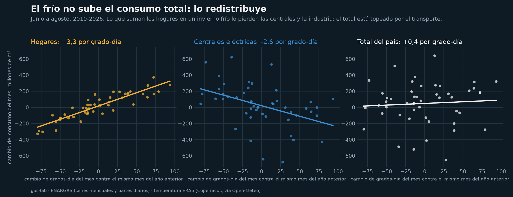
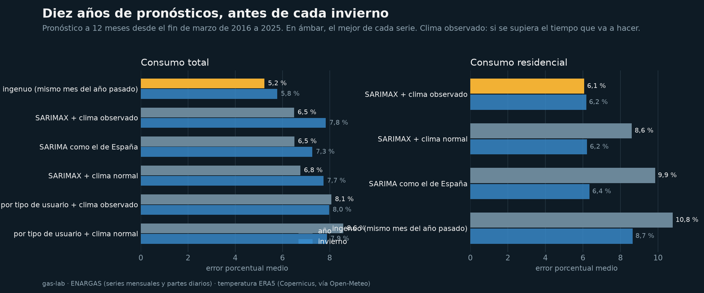
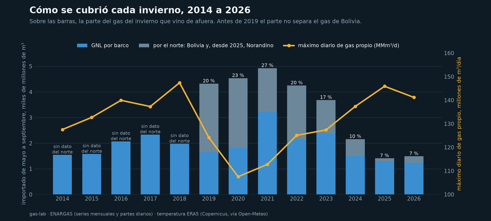
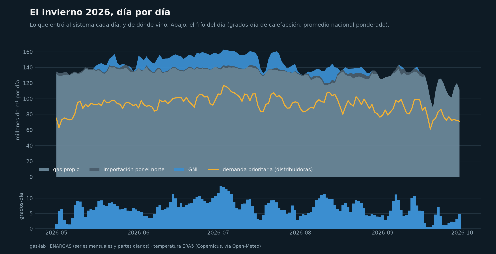
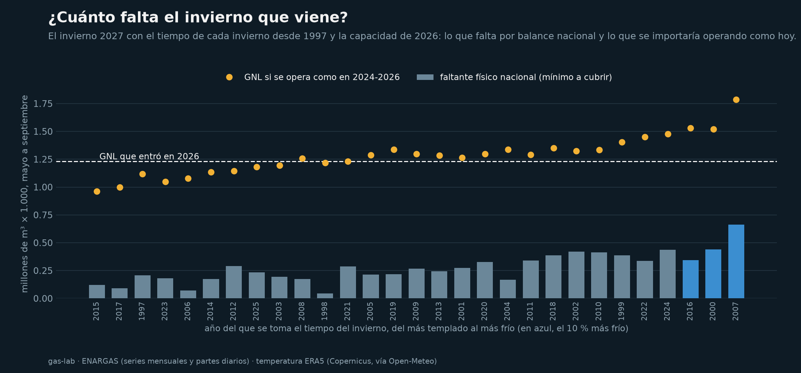
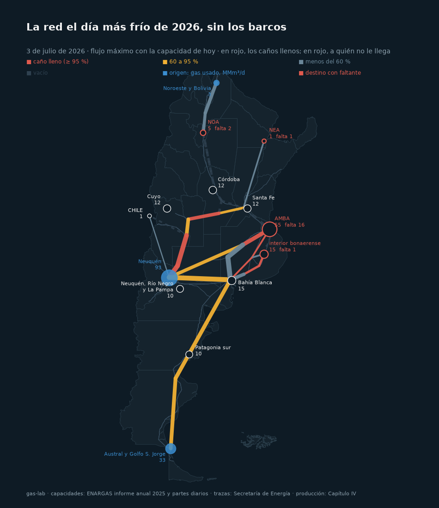
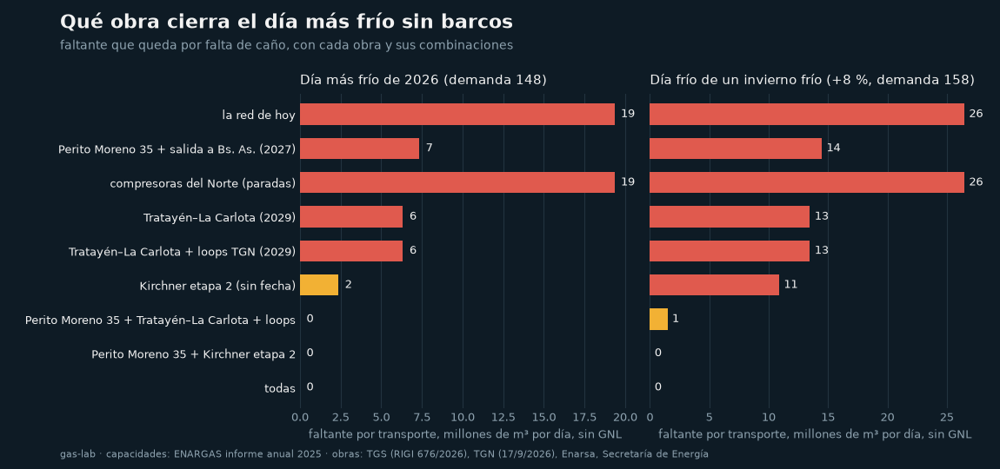
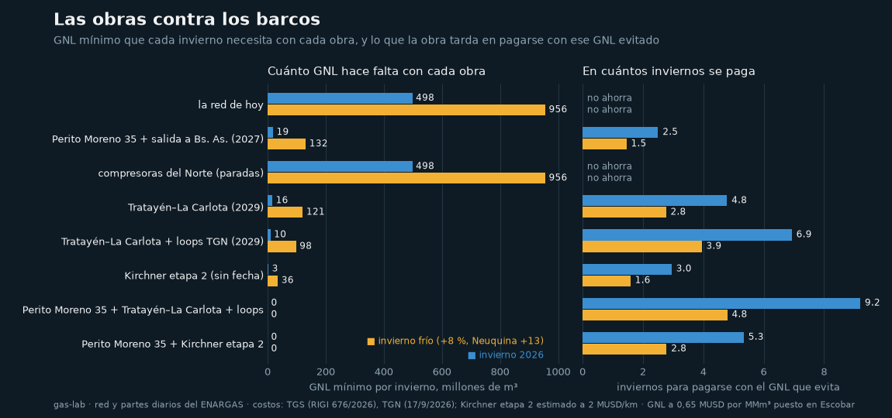

# gas-lab

¿Cuánto gas va a pedir la Argentina el invierno que viene, y alcanza en el día más frío? Con 30
años de consumo mensual del ENARGAS, más de 4.600 partes diarios desde 2014 y la temperatura
diaria de diez ciudades. Undécimo repo de la serie Sur Analytics.

> El frío no sube el consumo total de gas: lo redistribuye. En un invierno más frío los hogares
> consumen más y las centrales y la industria, casi lo mismo menos. El total de invierno no mide
> la demanda: mide lo que el sistema puede entregar. Y el GNL que se importa no depende de cuánto
> frío hace: se compra antes.



## De dónde sale

Un trabajo reciente pronosticó la demanda de gas de España con un SARIMA sobre 22 años de datos,
con un error del 5 % en el último año y sin temperatura. Este repo hace la misma pregunta para la
Argentina y le suma dos cosas: la temperatura diaria y los partes diarios del ENARGAS, que dicen
cuánto gas entró al sistema cada día y de dónde vino.

## Qué hace

| Notebook | Qué hace |
|---|---|
| `01_la_demanda_y_el_frio` | Consumo mensual 1996-2026 por tipo de usuario, las dos estacionalidades opuestas (hogares en invierno, centrales en verano), la redistribución del frío, diez años de pronósticos antes de cada invierno con cinco modelos, y el invierno 2027 con el tiempo de cada invierno desde 1997. |
| `02_alcanza_el_gas` | Los partes diarios 2014-2026: cómo se cubrió cada invierno (gas propio, GNL por barco, importación por el norte), el invierno 2026 día por día, la demanda prioritaria contra el frío del día, y cuánto faltaría el invierno 2027 con el tiempo de cada invierno desde 1997. |
| `03_la_red` | La red troncal como problema de flujo: las cinco cuencas, los gasoductos con la capacidad de cada tramo entre compresoras (ENARGAS, informe anual 2025) y la demanda del día más frío por distribuidora. Flujo máximo con la red de hoy, con y sin barcos: a quién no le llega y qué caños están llenos. Después, cada obra anunciada, sola y combinada. |

Las funciones están en `src/glab/`: `series.py` trae las series del ENARGAS por la API del
Estado; `clima.py` la temperatura ERA5 y los grados-día; `partes.py` baja y lee los partes
diarios (un PDF por día); `modelos.py` tiene el ingenuo, el SARIMA como el de España, el SARIMAX
con temperatura y el modelo por tipo de usuario; `validacion.py` los pronósticos desde cada año;
`escenarios.py` el abanico de inviernos; `pico.py` el balance diario; `figuras.py` dibuja. Tests
con datos sintéticos; los notebooks narran.

## Qué encontramos

**Dos estacionalidades opuestas.** Los hogares consumen 55 millones de m³ por día en julio y 10
en enero. Las centrales eléctricas tienen el pico en verano, 48 en enero, por el aire
acondicionado.

**El frío no sube el total: lo redistribuye.** Comparando cada mes de junio a agosto con el mismo
mes del año anterior desde 2010: cada grado-día de calefacción adicional suma 3,3 millones de m³
al mes en los hogares (correlación 0,90) y resta 2,6 en las centrales y 0,2 en la industria. El
total se mueve 0,4, con una correlación de 0,07. Cuando hace frío se prioriza a los hogares y se
corta a los demás: el total de invierno está topeado por el transporte.

**En el total, gana el más simple.** Diez pronósticos a 12 meses, uno desde el fin de marzo de
cada año entre 2016 y 2025:

| Modelo | Total: error medio | Hogares: error medio |
|---|---|---|
| Ingenuo: el mismo mes del año anterior | **5,2 %** | 10,8 % |
| SARIMA como el de España | 6,5 % | 9,9 % |
| SARIMAX con temperatura (clima normal) | 6,8 % | 8,6 % |
| SARIMAX con temperatura (clima observado) | 6,5 % | **6,1 %** |

El ingenuo iguala al SARIMA de España en el total, y la temperatura no lo mejora: el total no
responde al frío. En los hogares la temperatura sí manda, y el error baja a la mitad si se sabe
qué tiempo va a hacer.



**El invierno 2027 de los hogares.** Con el tiempo de cada invierno entre 1997 y 2025, el consumo
residencial de junio a agosto de 2027 va de 49,5 millones de m³ por día en un invierno cálido a
57,7 en uno frío, con 53,6 en uno normal.

**Cómo se cubrió cada invierno.** Con los partes diarios, de mayo a septiembre:

| Invierno | GNL por barco (millones de m³) | Por el norte | Parte importada | Máximo diario de gas propio (MMm³/d) |
|---|---|---|---|---|
| 2019 | 1.648 | 2.674 | 20 % | 124 |
| 2021 | 3.211 | 1.715 | 27 % | 113 |
| 2023 | 2.389 | 1.294 | 17 % | 127 |
| 2025 | 1.281 | 129 | 7 % | 146 |
| 2026 (a 1/9) | 1.017 | 209 | 7 % | 141 |

Bolivia se fue en 2024; lo que figura por el norte en 2025 y 2026 es el gasoducto Norandino, que
trae gas desde Chile. El gas propio máximo creció con el gasoducto Perito Moreno, y la parte
importada bajó de 27 % a 7 %. El GNL bajó, pero no desapareció, y no sigue al frío: entre 2021 y
2026 la correlación entre el GNL de cada invierno y sus grados-día es de -0,19.



**El día más frío de 2026.** El 3 de julio las distribuidoras entregaron 117 millones de m³, la
inyección total llegó a 163, el gas propio a 141 y el GNL a 20. Ese techo de gas propio, 141
millones de m³ por día, no se superó en todo el invierno.



**¿Cuánto falta el invierno que viene?** El modelo del día pone la demanda prioritaria en función
del frío con inercia (las casas tardan en enfriarse: con el frío del día solo explica la mitad
de la variación; con los días previos, el 76 %), suma la demanda directa sin cortes y la
diferencia entre inyección y consumo, y la compara con el techo de gas propio de 2026. Con el
tiempo de cada invierno desde 1997:

| Invierno 2027 con el clima de... | Días con faltante | Faltante físico (millones de m³) | GNL operando como 2024-2026 |
|---|---|---|---|
| un invierno cálido (p10) | 44 | 222 | 1.031 |
| uno normal (mediana) | 57 | 395 | 1.231 |
| uno frío (p90) | 72 | 584 | 1.417 |

El faltante físico nacional es el mínimo a cubrir; en 2026 fue un tercio del GNL que entró
(371 contra 1.017 millones de m³, con el calendario bien marcado: correlación diaria 0,64). La
diferencia tiene dos explicaciones. El GNL entra por Escobar, al lado del AMBA, y reemplaza gas
propio que no llega por los troncales aunque el total alcance: el cuello es regional. Y los
buques se contratan antes del invierno. Por eso la segunda columna, que mide cuánto GNL se usó en
cada nivel de frío entre 2024 y 2026, es la que más se parece a lo que va a pasar.



### Por dónde pasa el gas: la red como problema de flujo (notebook 3)

El gas está en un solo lugar y los caños que salen de ahí están llenos. La producción creció 42
millones de m³ por día en doce años y toda la suba fue de la cuenca Neuquina; las otras cuatro
cayeron. En el invierno 2026 Neuquén produjo 121 millones por día y los gasoductos que salen de
la cuenca hacia el resto del país suman 99 de capacidad: Neuba I y II (38), Perito Moreno (24) y
Centro Oeste (37). La cuenca produce lo que el caño deja sacar.

| Producción de invierno (jun-ago), MMm³/d | 2014 | 2019 | 2024 | 2026 |
|---|---|---|---|---|
| Neuquina | 64 | 90 | 113 | 121 |
| Austral | 28 | 35 | 24 | 25 |
| Golfo San Jorge | 14,5 | 13 | 10 | 8 |
| Noroeste | 8 | 5 | 3 | 3 |
| Total | 115 | 143 | 151 | 157 |

El sistema licenciado tiene 157 millones por día de capacidad nominal, sin cambios desde 2023 y
sin un metro cúbico nuevo en TGN desde 2015. Lo que importa es cuánto se usa de cada caño. En el
invierno 2026 (gas recibido por gasoducto, ENARGAS): Neuba I y II con el Perito Moreno, 74 de 72;
Centro Oeste, 37 de 34; Gasoducto Norte, 3 de 28; San Martín, 24 de 41. Los 42 millones de
capacidad libre están en los caños que vienen del norte y del sur, donde ya no hay gas.

Con eso se arma la red: las cuencas y las entradas de importación como orígenes, las compresoras
como nodos de paso, las áreas de las distribuidoras como destinos, y en cada arco la capacidad
operativa del tramo. El flujo máximo del 3 de julio de 2026, el día más frío, reproduce lo que
pasó: con los 20 millones de GNL de Escobar y los 2 de Bolivia, el sistema entrega los 148 que
se pidieron (quedan 0,9 sin asignar, dentro del error del reparto por nodo). Sin los barcos, la
misma red entrega 129: faltan 19, de los cuales 16 en el AMBA, y los caños saturados son los de
Neuquén a Bahía Blanca, de Ordoqui a Buenos Aires y la cabecera del Centro Oeste. El GNL no cubre
falta de gas: cubre falta de caño hacia el AMBA, que es donde entra.



Las obras, con las mismas reglas: cuánto faltante queda sin barcos con cada una, el día más frío
de 2026 tal cual fue y un día frío de un invierno frío (distribuidoras un 8 % arriba, Neuquén en
135).

| Obra | Capacidad que suma | Cuándo | Faltante 2026 | Faltante invierno frío |
|---|---|---|---|---|
| La red de hoy | | | 19 | 27 |
| Perito Moreno 21 → 35 y su salida al GBA (TGS, en obra) | +14 y +12 | abril 2027 | 7 | 15 |
| Compresoras del Gasoducto Norte (Enarsa, paradas) | +4 hacia el NOA | sin fecha | 19 | 27 |
| Tratayén–La Carlota (TGN) | +13 a Córdoba | abril 2029 | 6 | 14 |
| Tratayén–La Carlota + loops y compresión TGN | +13 y +14 | abril 2029 | 6 | 14 |
| Kirchner etapa 2, Salliqueló–San Jerónimo (proyectado) | +21 | sin fecha | 2 | 11 |
| Perito Moreno 35 + Tratayén–La Carlota + loops | | 2029 | 0 | 1,5 |
| Perito Moreno 35 + Kirchner etapa 2 | | sin fecha | 0 | 0 |



Ninguna obra sola cierra el día más frío sin barcos. Las compresoras del Norte no cambian nada en
el centro: llevan gas al NOA, donde el faltante es de 2. El Perito Moreno ampliado baja el
faltante del AMBA de 16 a 2 pero no toca el de Santa Fe y el NEA; el Tratayén–La Carlota hace lo
contrario. Lo que cierra el invierno es una obra hacia Buenos Aires más una hacia el centro: el
Perito Moreno de 2027 con el Tratayén–La Carlota de 2029, o el Perito Moreno con la etapa 2 del
Kirchner, que nadie tiene en agenda. Dos inviernos a barco como mínimo, y el de 2027 con el Perito
Moreno ampliado solo si la obra llega el 1 de abril.

**El invierno entero, contra los barcos.** El día más frío dice dónde está el cuello; los 153 días
de mayo a septiembre dicen cuánto cuesta. Para cada día se corre el flujo máximo sin barcos con la
demanda del parte y la producción de ese mes; el faltante del día es el GNL mínimo que ese día
necesita. Con la red de hoy son 498 millones de m³ en 83 días (correlación diaria con el GNL real,
0,82), más 96 en el NOA que el GNL no puede cubrir y que en 2026 trajo Bolivia. A 0,65 millones de
dólares por millón de m³ puesto en Escobar (2025 costó 0,54), cada obra se paga con el GNL que
evita:

| Obra | Costo (MUSD) | GNL mínimo, invierno 2026 | Inviernos para pagarse | Invierno frío: GNL mínimo | Inviernos para pagarse |
|---|---|---|---|---|---|
| La red de hoy | | 498 | | 956 | |
| Perito Moreno 35 + salida al GBA (2027) | 780 | 18 | 2,5 | 131 | 1,5 |
| Compresoras del Norte | sin publicar | 498 | no ahorra GNL | 956 | no ahorra GNL |
| Tratayén–La Carlota (2029) | 1.500 | 16 | 4,8 | 121 | 2,8 |
| Tratayén–La Carlota + loops TGN (2029) | 2.200 | 10 | 6,9 | 98 | 3,9 |
| Kirchner etapa 2 (estimado a 2 MUSD/km) | 950 | 3 | 3,0 | 36 | 1,6 |
| Perito Moreno + Tratayén–La Carlota + loops | 2.980 | 0 | 9,2 | 0 | 4,8 |
| Perito Moreno + Kirchner etapa 2 | 1.730 | 0 | 5,3 | 0 | 2,8 |



Las tres obras hacia el centro y Buenos Aires se pagan solas en dos a cinco inviernos; la que mejor
rinde por dólar es la que está en obra, el Perito Moreno, y la segunda es la que nadie tiene en
agenda, la etapa 2 del Kirchner. El GNL evitado es un piso: supone que Neuquén produce lo que el
caño nuevo deja sacar y no cuenta el gas que hoy se corta a la industria ni el gasoil de las
centrales. Y las compresoras del Norte no evitan un solo barco: su gas va al NOA, que es otro
problema, el de Bolivia.

## Limitaciones

- **La red es un flujo máximo, no una simulación hidráulica.** Sin presiones, line pack ni
  combustible de compresoras. Las capacidades por tramo del ENARGAS son flujos de diseño; donde
  el invierno 2026 mostró más (cabecera del Centro Oeste, Perito Moreno, Beazley–La Carlota sin
  exportación a Chile), se usa lo observado y se declara en el código. Un nodo por distribuidora:
  los usuarios directos de cada transportista se reparten con proporciones fijas porque el parte
  no dice dónde están, y los cortes dentro de un área no se ven. La demanda del parte es la
  entregada después de los cortes, así que el faltante real de un día frío es mayor.
- **El repago de las obras** usa el GNL que evitan a un precio fijo (0,65 MUSD por millón de m³)
  y supone que Neuquén produce lo que el caño nuevo deja sacar. No cuenta el gas que hoy se
  corta a la industria, el gasoil de las centrales ni las exportaciones que el caño permite: por
  eso es un piso. El costo de la etapa 2 del Kirchner es una estimación por kilómetro.

- **La temperatura** es la del reanálisis ERA5 en una ciudad por área de distribución, ponderada
  por el consumo total de cada distribuidora. En las áreas grandes, una ciudad es una
  aproximación.
- **Los partes diarios** son datos provisorios de las licenciatarias. Faltan 68 de más de 9.000,
  la mayoría de 2021. Antes de 2019 no separan el gas de Bolivia de la producción del norte; desde
  2019 algunos días no imprimen la nota y se interpola entre días vecinos.
- **La demanda directa en los días de corte** ya está recortada. Se estima su nivel sin cortes con
  los días templados del mismo invierno.
- **El balance es nacional** y no ve los cuellos regionales, que es donde el GNL de Escobar hace
  diferencia.
- **Todo supone la capacidad de 2026.** Una ampliación del transporte cambia el techo y la
  cuenta; los notebooks se vuelven a correr.
- **Sin precios.** Los aumentos de tarifa de 2016 a 2019 cambiaron el consumo por grado-día; los
  modelos los absorben con retraso.
- **Un buque, 85 millones de m³**, es un promedio (140.000 m³ de GNL a razón de 600 m³ de gas por
  m³ de GNL); los barcos de Escobar varían.

## Cómo correrlo

```
python -m venv .venv
.venv\Scripts\python.exe -m pip install -r requirements.txt
.venv\Scripts\python.exe -m ipykernel install --user --name gas-lab --display-name "gas-lab"
.venv\Scripts\python.exe scripts/download_data.py
.venv\Scripts\python.exe scripts/download_partes.py 2014-01-01 --invierno
.venv\Scripts\python.exe scripts/download_red.py
.venv\Scripts\python.exe -m pytest -q tests
.venv\Scripts\python.exe -m jupyter nbconvert --to notebook --execute --inplace notebooks/01_la_demanda_y_el_frio.ipynb
.venv\Scripts\python.exe -m jupyter nbconvert --to notebook --execute --inplace notebooks/02_alcanza_el_gas.ipynb
.venv\Scripts\python.exe -m jupyter nbconvert --to notebook --execute --inplace notebooks/03_la_red.ipynb
```

La descarga de los partes pide al servidor del ENARGAS con seis pedidos a la vez; los inviernos
tardan una hora y el año completo, dos. La primera lectura de los PDF tarda unos 25 minutos y
queda guardada. En Linux, en lugar de `.venv\Scripts\python.exe`, `.venv/bin/python`.

## Datos y licencias

- ENARGAS, "Producción y consumo de gas natural", por la API de series de tiempo de
  datos.gob.ar: <https://datos.gob.ar/series>
- ENARGAS, partes diarios operativos (gas distribuido y gas transportado):
  <https://www.enargas.gob.ar/secciones/transporte-y-distribucion/dod-partes-dist-trans.php>
- ERA5, Copernicus Climate Change Service (ECMWF), vía el archivo histórico de Open-Meteo
  (CC BY 4.0): <https://open-meteo.com/en/docs/historical-weather-api>
- Secretaría de Energía, producción de gas natural por cuenca (Capítulo IV) y gasoductos de
  transporte y plantas compresoras (capas del ENARGAS), CC BY 4.0: <http://datos.energia.gob.ar>
- ENARGAS, informe anual 2025, capacidad de inyección por gasoducto y operativa por tramo entre
  compresoras (páginas 203 a 205) y gas inyectado por cuenca (209), transcriptas en `data/`:
  <https://www.enargas.gob.ar/secciones/publicaciones/informes-anuales-de-balance-y-gestion/>
- ENARGAS, datos operativos de transporte (gas recibido por gasoducto, contratos firmes):
  <https://www.enargas.gob.ar/secciones/transporte-y-distribucion/datos-operativos-subsec.php?sec=2&subsec=4&subsecord=04>
- IGN, capa de provincias por WFS: <https://wms.ign.gob.ar/geoserver>
- Obras: TGS, ampliación del Perito Moreno (RIGI, Res. 676/2026); TGN, Gasoducto Manuel Belgrano
  Tratayén–La Carlota (anuncio del 17/9/2026); Enarsa, reversión del Gasoducto Norte.
- El trabajo sobre España que inspiró la comparación: Diego Agudo,
  <https://github.com/diegoagudoa-eng/gas-demand-forecasting-sarima>

Código con licencia MIT.

## Autor

Diego Piñero, Sur Analytics.
